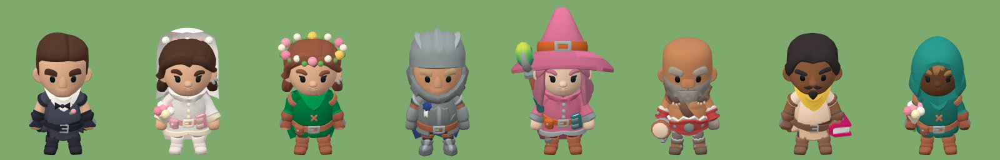

# kaykit — 3D 캐릭터를 미리 구운 스프라이트

방명록 캐릭터 그림체 `kaykit` 의 에셋을 만드는 빌드 도구. **앱 실행에는 three.js 가 들어가지 않는다** —
여기서 3D 모델을 조각별 2D 그림으로 구워 두고, 앱(`web/src/guestbook/styles/kaykit/`)은 그 그림을 2D 캔버스에서 겹칠 뿐이다.

원본: **KayKit : Adventurers Character Pack 2.0 (FREE)** — Kay Lousberg, CC0 1.0. 자세한 출처·라이선스는 [LICENSE.md](LICENSE.md).



## 파일

| 파일 | 하는 일 |
| --- | --- |
| `raw/` | 원본 팩에서 가져온 파일 (아래 "원본 받기") |
| `config.mjs` | 굽기 설정: 카메라·조명·걷기 프레임, 의상/머리/액세서리 목록, 팔레트 다시 칠하기 규칙, 색 목록, 직접 만든 소품(면사포·부케·화관·나비넥타이) |
| `render.html` · `render-page.js` | 헤드리스 크롬에서 도는 three.js 렌더러 (한 칸씩 굽는다) |
| `kit.mjs` | 정적 서버 + 크롬 실행 + PNG 입출력 |
| `build.mjs` | 전체 굽기 → `web/src/guestbook/styles/kaykit/assets/{atlas.webp, mask.webp, atlas.ts}` |
| `proof.mjs` | 구운 WebP 를 **앱의 실행 코드(compose.ts)** 로 조합해 확인용 시트·GIF·`preview.png` 를 만든다 |
| `probe.mjs` | 살펴보기용 (메쉬 목록·경계 상자·걷기 클립의 발 위치, 임의 메쉬 묶음 렌더) |

## 다시 굽기

필요한 것: Node 22.18+ (proof 가 `.ts` 를 바로 읽는다), Google Chrome, `cwebp`·`dwebp` (libwebp — `brew install webp`), GIF 를 만들려면 `ffmpeg`.

```sh
cd art/kaykit
npm install            # three · puppeteer-core · pngjs (node_modules 는 저장소에 올리지 않는다)
node build.mjs         # 약 2분. 헤드리스 크롬(SwiftShader 소프트웨어 WebGL)으로 굽는다
node proof.mjs --gif --out /tmp/kaykit-proof   # walk.png · walk.gif + preview.png
cd ../../web && npx vitest run src/guestbook/styles/kaykit
```

- 의존성을 다른 곳에 설치했다면 `--modules <node_modules 경로>` 를 준다.
- 크롬이 다른 곳에 있으면 `CHROME=/path/to/chrome`.
- 중간 결과(PNG)는 `out/` 에 남는다 (`.gitignore`).
- 옵션 개수(머리·의상·액세서리·색)를 바꿨다면 `web/src/guestbook/styles/registry.ts` 의 `STYLE_META.kaykit.counts`·`GUEST_EXCLUDED` 도 맞춘다.

## 원본 받기 (`raw/`)

저장소에 이미 들어 있다 (약 3.8MB). 다시 받으려면 <https://kaylousberg.itch.io/kaykit-adventurers> 에서
"Free 2.0" (`KayKit_Adventurers_2.0_FREE.zip`, 약 13MB) 을 받아 아래처럼 옮긴다:

| zip 안의 경로 | 옮길 곳 |
| --- | --- |
| `Characters/gltf/{Barbarian,Knight,Mage,Ranger,Rogue,Rogue_Hooded}.glb` | `raw/characters/` |
| `Animations/gltf/Rig_Medium/Rig_Medium_{General,MovementBasic}.glb` | `raw/animations/` |
| `Assets/gltf/{mug_full,spellbook_closed,staff,wand}.{gltf,bin}` + `{barbarian,mage}_texture.png` | `raw/assets/` |
| `License.txt` | `raw/License.txt` |

## 어떻게 굽나

- **카메라**: 직교 투영, 24° 내려다보기. 프레임 상자 200x256, 발바닥(무대 원점)이 위에서 240번째 줄. 4배로 크게 그린 뒤(+MSAA) 평균으로 줄인다.
- **방향**: 무대를 Y 축으로 0°/±90°/180° 돌려 4방향을 모두 실제로 굽는다 (좌우 반전 없음).
- **프레임**: 0 = `Idle_A` 의 첫 자세, 1·2 = `Walking_A` 에서 두 발이 가장 벌어지는 두 순간 (0.36초 · 0.893초).
- **조각(레이어)**: 캐릭터 6명이 같은 뼈대를 쓰므로 모두 같은 자세로 겹쳐 세워 두고 필요한 메쉬만 켠다.
  - 몸(의상) = Body + Arm + Leg (+ Cape), 머리 = Head. 각각 통째로 굽는다. 앱은 몸 → 머리 순서로 겹친다.
  - 액세서리(모자·손에 든 물건)는 두 장: **over** = 가리개(몸·머리)를 깊이만 그린 상태에서 보이는 부분, **under** = 전체 − over (가려지는 부분).
    앱은 under → 몸 → 머리 → over 순서로 그린다. 그래서 다른 머리·몸과 섞어도 앞뒤가 맞는다 (머리가 작으면 under 가 그 뒤로 비쳐 보인다).
    모자의 가리개는 "그 모자의 원래 머리 + 모든 몸", 손에 든 물건의 가리개는 "모든 머리 + 모든 몸".
- **색 바꾸기**: 모델은 8x4 칸짜리 그라데이션 팔레트 텍스처 한 장을 쓴다. 블록마다 "피부 / 머리카락 / 옷감 / 고정 색 / 그대로" 를 정해(`config.mjs` 의 `paint`)
  - 색 그림에는 그 블록을 **밝기만 남긴 중립 회색(184)** 으로 바꿔 굽고,
  - 마스크에는 R = 피부, G = 머리카락, B = 옷감 비율을 굽는다 (조명 없이).
  - 앱은 `픽셀 x (1 + 비율 x (고른 색 / 184 − 1))` 로 칠한다. 램버트 조명 + sRGB 에서는 곱셈이 거의 그대로 유지되어 음영이 살아 있다.
  - 신랑·신부 옷은 실행 때 바꾸는 색이 아니라 구울 때 고정 색으로 다시 칠한 별도 레이어다.
- **직접 만든 소품**: 팩에 결혼식 소품이 없어서 면사포·부케·화관·나비넥타이·부토니에르는 three.js 기본 도형(회전체·원뿔·정이십면체)으로 만들어 뼈에 붙였다.
- **뺀 것**: 무기·방패·화살통(활 포함), 기사 투구의 얼굴 가리개. 손에 드는 것은 머그잔·책·지팡이·요술봉·꽃다발만.
- **압축**: 색은 손실 WebP(q88, 알파 무손실), 마스크는 무손실 WebP.
